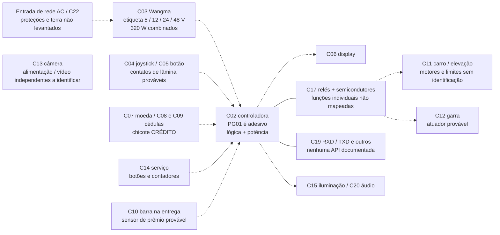

# 03 — Reconstrução da arquitetura eletrônica

Base: [37 fotos](01-inventario-fotografico.md), [identificação](02-identificacao-hardware.md), consulta de 21/10/2026. **Não é esquema elétrico nem pinagem de instalação.** CONFIRMADO refere-se à observação especificada, PROVÁVEL a uma hipótese e NÃO IDENTIFICADO a uma lacuna. Nenhuma ligação foi testada.

## Arquitetura sustentada pelo exemplar

A controladora C02 reúne lógica e acionamento: há sete relés C17, dissipador, semicondutores de potência, capacitores e muitos conectores. Dois CIs lógicos C23/C24 têm inscrição 74HC245D legível; suas ligações não foram rastreadas. A fonte C03 é multissaída, não uma fonte simples de 5 V. O carro/garra C11/C12 e os controles C04/C05 são blocos fisicamente distintos. A câmera C13 não tem conexão à controladora demonstrada. Isso favorece acrescentar uma interface aos comandos e um caminho separado de vídeo, preservando o controle original dos atuadores, se a validação permitir.

Linhas contínuas representam **presença no mesmo conjunto/PCB**, não rastreamento elétrico de trilhas. Tracejadas representam conexões funcionais **PROVÁVEIS** cujo trajeto integral não está comprovado. C13 fica sem ligação porque seu destino não foi identificado. Não há Ethernet/Wi-Fi/Internet comprovados na C02. Os nomes dos eixos são funcionais: não foi identificado um motor individual para cada eixo.

## Funcionamento: respostas por função

| Função | O que as evidências permitem dizer | O que falta determinar |
|---|---|---|
| 1. Entrada elétrica | C03 recebe AC segundo etiqueta 100–240 V; cabo de entrada aparece em F27/F28. C22 mostra distribuição parcial | Tipo de entrada, proteção, fusíveis, aterramento, seccionamento, tensão local e eventuais ramais; NÃO IDENTIFICADOS |
| 2. Alimentação da placa | LEDs/serigrafia 48/12/24/5 V de C02 são coerentes com as saídas nominais de C03. Chicotes aparecem entre os conjuntos | PROVÁVEL distribuição multitrilho; rastreio de cada condutor, retornos e valores medidos faltam. LED aceso não mede tensão correta |
| 3. Comandos do jogador | Joystick, botão e display convivem no painel F05. F06–F09 mostram candidato a base mecânica com lâminas | PROVÁVEL sinal por contato; não se sabe se discreto, matriz, contato multipolar ou potência. Caminho até C02 não rastreado |
| 4. Captura | Um botão circular existe; sua função de captura é coerente com máquina e painel | PROVÁVEL gatilho de sequência original; não há identificação de seu contato, duração mínima ou se também inicia partida |
| 5. Crédito e início | C07 é comparador de moeda; há dois mecanismos de cédulas e chicote CRÉDITO. Tela solicita moeda | PROVÁVEL habilitação por crédito; não sabemos relação dinheiro/pulsos, inhibit, polaridade, partida automática, consumo por movimento ou botão. Pix impresso não comprova integração |
| 6. Movimento horizontal | C11 tem trilhos, roletes e engrenagens; C02 reúne relés/potência | PROVÁVEL acionamento de motores pela PCB; tipo DC/AC/passo, reversão, corrente, velocidade e ligação de cada relé desconhecidos |
| 7. Descida | Garra suspensa no carro, com cabos e estrutura de elevação | PROVÁVEL motor/reel de elevação comandado pela sequência original. Sensor de frouxidão/altura e mecanismo real de parada inferior NÃO IDENTIFICADOS |
| 8. Fechar/abrir garra | C12 tem cilindro, haste e bielas que articulam os três dedos | PROVÁVEL solenoide; não sabemos tensão, forma de onda, força de aperto/manutenção, retorno por mola ou sequência. Não atribuir 48 V à garra só pela fonte |
| 9. Fim da partida | Display apresenta tempo; mecânica precisa devolver garra e liberar prêmio | PROVÁVEL máquina de estados interna com temporização e retorno; ordem, eventos e sinais de fim NÃO IDENTIFICADOS |
| 10. Sensores de posição | Mecanismo precisa limitar deslocamento de alguma maneira, mas fotos não revelam modelo/ligação de nenhum limite com segurança | Fim de curso físico, encoder, corrente e temporização são hipóteses distintas. Não afirmar proteção operacional existente |
| 11. Premiação | C10 está no compartimento de entrega e tem múltiplos elementos/CI; chicote PRÊMIO em F24 | PROVÁVEL detector óptico de passagem; falta demonstrar vínculo entre barra, etiqueta, C02 e contagem. Passagem não equivale automaticamente a prêmio entregue ao usuário |
| 12. Manutenção | C14 tem botões, chave, voltímetro e dois contadores; C02 tem SET | Presença CONFIRMADA; função de cada botão/contador e se altera créditos, força ou configuração NÃO IDENTIFICADA |
| 13. Proteções originais | Há gabinete, carcaça de fonte, conduítes, fixações e componentes de potência | Não comprovados parada de emergência, proteção anti-esmagamento, supressão, sobrecorrente ou atuação dos limites. Garra pode cair ao retirar energia; requer avaliação |
| 14. Controle externo | Entradas dos controles são o candidato A; RXD/TXD é candidato B; substituição de potência é C | Compatibilidade de qualquer ligação externa NÃO VALIDADA. D-sub e ilhas de sinais não são portas de comando documentadas |

O fabricante e firmware exatos não foram identificados; a reconstrução termina no nível de blocos. Não contamos partidas apenas pelo relógio do site nem interpretamos os contadores de C14 como telemetria documentada.

## Identificadores de conectores desta investigação

Estes são rótulos **locais**, não nomes de fabricante nem números de pino:

- **J-PWR:** conector branco superior de C02, vizinho ao D-sub, com vários condutores de alimentação.
- **J-DSUB:** D-sub superior de C02; quantidade exata e gênero requerem face de contatos.
- **J-SER:** header branco lateral superior direito, ao lado de `12V GND RXD TXD 5V`; cinco posições aparentes, sem orientação/pinagem validada.
- **J-PADS:** fileira de oito ilhas na borda inferior esquerda, com `5V OE RC SC DAT 12V GND GNDP` legível. A última grafia deve ser confirmada por macro.
- **J-CENT:** header branco central de C02, aparentemente quatro vias; sem destinação comprovada.
- **J-B1…J-B4:** quatro carcaças brancas inferiores, numeradas da esquerda para direita **na orientação de F20**; não aplicar esse índice como numeração elétrica.
- **J-GARRA:** plugue intermediário branco de F03; não se sabe se serve só a garra ou a todo o carro.
- **J-BARRA:** conector de C10, quatro condutores visíveis; número de cavidades/orientação a confirmar.
- **J-LCD:** conector longo do verso C06; total de contatos e condutores não contáveis com segurança por foco/oclusão.

Não foi identificada a série comercial de nenhum desses conectores. Não chamar todos de JST/Molex nem escolher plugue pelo plástico branco. Contagem de fios não equivale a contagem de vias ou circuitos independentes.

## Matriz A — trechos e relações visualmente comprovados

“CONFIRMADO” nesta tabela vale para **o trecho local visível**; não implica que a ligação chegue a outro bloco fora do enquadramento.

| Origem | Destino visualmente observado | Conector | Vias/condutores visíveis | Função observada ou possível | Foto | Confiança | Validação física necessária |
|---|---|---|---|---|---|---|---|
| Chicote no alto do compartimento | C02 | J-PWR | Cerca de 6 condutores; cavidades a confirmar | Entrada próxima aos indicadores de tensões; alimentação PROVÁVEL | F19/F20/F25/F26 | CONFIRMADO trecho; PROVÁVEL função | Rastrear até fonte e registrar cada posição/referência |
| Chicote multicolorido | C02 | J-DSUB | Multipinos; total não confirmado | Conexão instalada; função desconhecida | F18–F20 | CONFIRMADO presença | Fotografar face e rastrear, sem assumir padrão de comunicação |
| C02 | Header lateral exposto | J-SER | 5 posições aparentes, sem chicote visível nesse header | Inscrições RXD/TXD e alimentação | F19/F20 | CONFIRMADO inscrição; PROVÁVEL enlace serial | Identificar circuito, níveis, referência e uso no firmware |
| C02 | Ilhas expostas na própria placa | J-PADS | 8 ilhas visíveis | Candidato a expansão/display; não há cabo instalado ali comprovado | F19/F20 | CONFIRMADO forma/legendas | Trilha/CI/documentação; não tratar ilhas como GPIO livres |
| Chicotes inferiores | C02 | J-B1…J-B4 | 4 carcaças; J-B2 mostra 5 condutores na ampliação de F25, outras multipolares parcialmente ocultas | Funções não atribuídas | F19/F20/F25/F26; recorte F25-conectores-inferiores | CONFIRMADO trechos/condutores visíveis | Contar cavidades e identificar endpoints de todos os fios |
| Chicote do painel | C06 verso | J-LCD | Conector longo multipolar, total não seguro | Alimentação e interface do display PROVÁVEIS | F06–F09 | CONFIRMADO chegada ao LCD | Modelo e especificação do módulo e origem do chicote |
| Chicote multicolorido superior | Chicote com proteção metálica | J-GARRA | Múltiplas vias; total oculto | Continuidade mecânica de ligação de F03 | F03 | CONFIRMADO encaixe visível | Funções, capacidade e correspondência de cada lado |
| Cabo helicoidal branco | Região do cilindro C12 | Sem designador legível | Condutores internos invisíveis | Cabo de atuador PROVÁVEL | F02 | CONFIRMADO trajeto parcial | Identificar conexão e bobina sem atribuir tensão |
| C10 | Chicote descendente na parede | J-BARRA | 4 condutores visíveis | Ligação local à barra; sinal e alimentação não separados | F21/F22/F31 | CONFIRMADO trecho | Rastrear até C02/chicote PRÊMIO e caracterizar interface |
| C07 placa lateral | Chicote branco lateral e fita plana no módulo | Sem código legível | 4 condutores aparentes no chicote externo; fita com total não seguro | Interface externa e interligação interna do aceitador | F11–F16 | CONFIRMADO presença | Identificar modelo, sinal de crédito e eventual inibição |
| C13 | Cabo branco seguindo fundo | Não visível | Um cabo com condutores internos desconhecidos | Alimentação/dados desconhecidos | F04/F35/F37 | CONFIRMADO trecho | Etiqueta da câmera, fonte e destino do cabo |
| C03 carcaça | Cabo que sai no alto | Entrada de fonte não individualizada | Um cabo; condutores internos não vistos | Entrada AC segundo etiqueta PROVÁVEL para esse cabo | F27/F28 | CONFIRMADO cabo; PROVÁVEL função | Inspeção da entrada/proteções por profissional |

## Matriz B — conexões funcionais ainda hipotéticas

| Origem | Destino proposto | Conector | Vias visíveis de ponta a ponta | Hipótese | Fotos que sustentam | Confiança | Validação física que falta |
|---|---|---|---|---|---|---|---|
| C03 | J-PWR de C02 | Não rastreado integralmente | NÃO IDENTIFICADO | Alimentação multissaída | F20/F24/F28 | PROVÁVEL | Identificar pares e trilhos, tensão real e carga |
| C04 | Entradas C02, diretamente ou por outra placa | NÃO IDENTIFICADO | NÃO IDENTIFICADO | Direções por contatos | F05–F09/F20 | PROVÁVEL | Unir eixo/base, terminais e endpoint por levantamento desenergizado |
| C05 | Entrada C02 | NÃO IDENTIFICADO | NÃO IDENTIFICADO | Captura por acionamento momentâneo | F05/F20 | PROVÁVEL | Identificar contatos separados da iluminação e destino |
| C07/C08/C09 | Crédito C02 | Chicote CRÉDITO visto, endpoints pendentes | NÃO IDENTIFICADO | Habilitação de jogo | F11–F17/F24 | PROVÁVEL | Modelo, documentação e semântica de crédito/partida |
| C02/potência | Motores C11 e atuador C12 | J-DSUB ou outro, ainda não atribuível | NÃO IDENTIFICADO | Movimento/elevação/garra | F02/F18–F20 | PROVÁVEL | Rastrear circuito; não atribuir um relé a cada direção por contagem |
| Limites de curso desconhecidos | C02 ou circuito de potência | NÃO IDENTIFICADO | NÃO IDENTIFICADO | Parada/referência de movimento | Mecânica F02; nenhuma evidência direta de sensor | NÃO IDENTIFICADO | Encontrar fisicamente sensores e ligação; demonstrar comportamento |
| C10 | C02/chicote PRÊMIO | NÃO IDENTIFICADO | NÃO IDENTIFICADO | Evento de prêmio | F22/F24/F31 | PROVÁVEL | Rastrear, entender saída e registrar resposta a passagem posteriormente |
| C14 | C02 | NÃO IDENTIFICADO | NÃO IDENTIFICADO | Configuração/crédito/contagem/ajuste | F20/F34 | PROVÁVEL | Legendas/manuais e circuito antes de usar botões |
| Alimentação/driver desconhecidos | C15 e C20 | NÃO IDENTIFICADO | NÃO IDENTIFICADO | Luz e áudio | F24/F32 | PROVÁVEL | Localizar alimentação, comando e proteção |

Nenhuma linha hipotética deve virar cabo de instalação. O próximo ganho de evidência é um mapa dos controles C04/C05, preservando a PCB e documentando suas ligações antes de qualquer escolha de interface.
