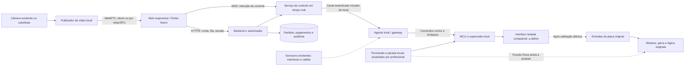

# 07 — Arquitetura conceitual do controle remoto

Data da investigação: 21/10/2026. Escopo: projeto conceitual; nenhum aplicativo, firmware ou acionamento físico foi implementado ou testado.

## 1. Decisão possível com as evidências atuais

A linha prioritária de investigação é **preservar a placa original e reproduzir somente as entradas do jogador**, mediante interface eletricamente compatível e reversível. Isso é uma proposta condicionada ao resultado de [04 — Investigação dos controles](04-investigacao-controles.md), e não uma adaptação já validada.

As fotografias mostram o joystick e o botão pela face externa (F05), a placa principal com relés e conectores (F18–F20/F25–F26), a garra e o carro (F02), uma câmera instalada (F04/F37), mecanismos de aceitação de pagamento (F10–F17/F32–F33) e uma placa alongada na região de premiação (F21–F22/F31). F06–F09 mostram um conjunto interno de suportes amarelos, lâminas metálicas e eixo claro compatível com a base do joystick, mas o foco e o ângulo não permitem fechar sua ligação elétrica. Faltam vistas nítidas/orientadas dos terminais do joystick e do botão e documentação da barra e da câmera. Portanto:

| Elemento | Classificação | Consequência arquitetural |
|---|---|---|
| Placa e controles originais presentes | CONFIRMADO | Preservar o sequenciamento original é uma alternativa concreta a investigar. |
| Joystick com contatos eletromecânicos | PROVÁVEL | Conjunto de lâminas de F06–F09 reforça a hipótese; independência, referência comum, pinagem e polaridade continuam NÃO IDENTIFICADO. |
| Placa com etiqueta `PG01` aceita API/protocolo externo | NÃO IDENTIFICADO | Inscrições `RXD`/`TXD`, quando visíveis, não demonstram protocolo acessível nem autorização de comando. |
| Câmera instalada pode fornecer vídeo local de baixa latência | NÃO IDENTIFICADO | Reutilização depende de modelo, protocolo, acesso local e medição. |
| Barra na saída é detector de premiação | PROVÁVEL | Não usar como confirmação de prêmio até identificar e validar sinal e geometria. |
| Soltar o joystick interrompe todo movimento, inclusive o ciclo automático | NÃO IDENTIFICADO | Timeout de comandos não pode ser anunciado como parada mecânica completa. |

Nenhum fabricante, arquitetura interna ou tecnologia da plataforma concorrente foi deduzido para este desenho.

## 2. Separação funcional proposta

As setas pontilhadas são dependências ainda não comprovadas. `Gateway` é uma função, não uma exigência de Raspberry Pi. Para controle simples, o agente de rede e a lógica local podem coexistir num MCU apropriado. Um computador Linux pode ser necessário para publicar/converter vídeo ou integrar uma câmera; seu travamento não pode manter uma saída de controle ativa.

## 3. Componentes e responsabilidades

| Camada | Responsabilidade | O que precisa ser confirmado nesta máquina |
|---|---|---|
| Aplicação web | Mostrar vídeo, fila, disponibilidade, tempo de partida, joystick virtual, captura e qualidade de conexão. | Orientação real frente/trás e melhor enquadramento da garra/saída. |
| Backend | Autenticar; reservar máquina; arbitrar um único jogador; coordenar pagamento, crédito, fila e registro. | Como confirmar estado ocioso, início e encerramento na placa original. |
| Serviço de controle | Validar sessão, limitar taxa, encaminhar intenções recentes e devolver estados. | Latência viável entre jogadores, servidor e Tobias Barreto. |
| Agente local | Conexão de saída autenticada; rejeição de mensagens antigas; telemetria; comunicação com MCU. | Rede local, energia auxiliar e câmera. |
| MCU/supervisor | Limitar duração, impedir opostos, aplicar modo local, expirar permissão e manter saídas inativas ao ligar. | Quantidade e natureza elétrica dos canais. ESP32 é candidato, não compra definida. |
| Interface eletrônica | Reproduzir o comportamento medido dos comandos sem introduzir tensão indevida ou terra comum não projetado. | Contatos versus matriz/analógico/digital; níveis, correntes, fugas e isolamento necessários. |
| Publicador de vídeo | Obter imagem local, codificar quando necessário e publicar WebRTC. | Marca/modelo/protocolo da câmera visível, codec e atraso. |
| Proteção local | Impedir controle remoto durante manutenção e executar resposta física segura a falhas. | Circuito de parada/disable, movimento por gravidade e comportamento do ciclo automático. |

Para um ESP32, a documentação descreve watchdogs de interrupção e de tarefas para detectar falhas de execução. Isso justifica investigar o MCU como supervisor, mas não demonstra que seu watchdog, sozinho, desative uma interface externa nem constitui certificação de segurança. A seleção do componente e de uma supervisão elétrica independente depende da análise de falhas. [Espressif — Watchdogs](https://docs.espressif.com/projects/esp-idf/en/stable/esp32/api-reference/system/wdts.html).

## 4. Exclusividade, autorização e estados

### 4.1 Estados da máquina no sistema

Proposta inicial:

`OFFLINE → SYNCHRONIZING → IDLE → RESERVED → ARMING → PLAYING → CAPTURE_PENDING → CYCLE_RUNNING → RECONCILING → IDLE`

`FAULT` e `MAINTENANCE` podem ser alcançados de qualquer estado e bloqueiam novas autorizações. Ao ligar ou reconectar, entrar em `SYNCHRONIZING`, com saídas inativas. Voltar a `IDLE` exige evidência de máquina livre e liberação local; não basta o servidor ter esquecido a partida.

Os estados são do software proposto. Não foram lidos no firmware original. Enquanto não houver sensores ou telemetria confiáveis, um operador deverá confirmar condições críticas. Temporizadores podem detectar atraso ou suspeita de falha; não devem declarar, sozinhos, “garra em repouso”, “prêmio entregue” ou “partida encerrada”.

### 4.2 Direito exclusivo de controlar

Cada máquina terá uma reserva atômica no backend e uma autorização curta de controle (`lease`). Ela conterá identidade da máquina, partida, jogador, expiração e um número crescente de geração (`epoch`/fencing token). O dispositivo local aceitará apenas a geração ativa e bloqueará qualquer jogador anterior, mesmo se chegar uma mensagem atrasada por outro servidor.

A geração precisa sobreviver a reinício ou ser substituída por nova negociação autenticada vinculada à inicialização atual. Uma cópia antiga do backend não pode emitir geração inferior e recuperar o comando. A expiração terá limite local conservador, baseado em relógio monotônico, com tolerância de relógio definida e verificada. Se a validade não puder ser demonstrada, liberar as saídas e negar novos comandos.

Pagamentos autorizam o backend a preparar a partida; não concedem ao navegador acesso à rede da máquina. A camada local verifica também permissão física/local, estado e validade da sessão. Espectadores recebem apenas vídeo e estados públicos.

## 5. Contrato conceitual dos comandos

Cada mensagem futura deverá conter versão de protocolo, `machine_id`, `boot_id`, `session_id`, geração, sequência monotônica, tipo de comando e identificador único. Validade curta e prazo da autorização serão verificáveis pelo agente local; o relógio arbitrário do navegador não é fonte de confiança.

O prazo não pode começar apenas quando um pacote chega ao MCU: uma mensagem presa num buffer já pode estar velha. O protocolo deve verificar idade desde a origem autorizada mediante relógios com erro máximo conhecido e prazo conservador, ou por uma janela/nonce emitida localmente com vencimento monotônico. Se essa validade não for demonstrável, rejeitar. A implementação futura deve ensaiar especificamente backlog TCP, pausa do processo e relógio dessincronizado. O canal aceitará somente funções de jogo previstas; nunca uma API genérica de GPIO, configuração da PCB ou execução de código recebida do navegador.

### Movimento

- Enviar **estado desejado atual** (`esquerda`, `direita`, `frente`, `trás` ou `neutro`), sem fila acumulativa de movimentos.
- Atualizações renovam apenas uma permissão curta e limitada localmente. A autorização da sessão precisa continuar válida. Mensagens expiradas ou fora de ordem não renovam o prazo.
- Uma duração máxima contínua por direção deve ser definida no levantamento físico e aplicada localmente mesmo se chegarem renovações; uma interface de toque travada não pode manter o movimento indefinidamente. A duração da partida também limita a autorização.
- Começar com uma direção de cada vez. Diagonais somente após provar a compatibilidade do controle original. Esquerda+direita e frente+trás são sempre rejeitadas.
- Ao mudar de direção, aplicar a transição necessária à interface validada; não supor que ausência de intervalo entre saídas seja aceitável.
- A aplicação envia `neutro` ao soltar, perder foco ou receber cancelamento do toque; a expiração local cobre o caso em que essa mensagem não chega.
- Uma transmissão bloqueada deve descartar estado de movimento vencido. Reconexão exige comando novo; não reproduz `keydown`, movimento retido ou fila antiga.

### Captura e crédito

Captura é um evento discreto, permitido uma vez na fase correta de cada partida e com duração de saída definida pela validação elétrica. Depois de aceitar captura, o software bloqueia novos movimentos até conhecer o comportamento do ciclo original. “Captura aceita” não significa “garra desceu”.

Crédito/início é uma operação independente. As etiquetas `CRÉDITO` e os mecanismos de pagamento nas fotos não definem nível, pulso, isolamento ou semântica. O primeiro protótipo poderá receber crédito pelo método original, operado localmente, antes de existir qualquer automação dessa entrada.

Eventos de crédito/captura terão chave idempotente persistida antes de comandar. Se ocorrer reinício na janela entre registrar a intenção e observar o efeito físico, marcar `RESULTADO_DESCONHECIDO` e reconciliar; **não repetir o pulso automaticamente**. Persistência evita reexecução deliberada, mas sem retorno físico documentado não há garantia de execução física exatamente uma vez.

### Retornos com significado explícito

| Retorno | O que comprova | O que não comprova |
|---|---|---|
| `received` | Mensagem recebida pelo agente local. | Aceitação, saída elétrica ou movimento. |
| `accepted` | Mensagem validada para a sessão e o estado. | Que o contato externo foi efetivamente reproduzido. |
| `output_applied` | Firmware solicitou o estado da saída; diagnóstico adicional pode verificar a interface. | Que a placa original reconheceu a entrada ou o motor moveu. |
| `observed` | Uma entrada/sensor validado observou um estado identificado. | Eventos de outros sensores ou resultado comercial não medido. |
| `unknown` | Não há evidência suficiente do efeito físico. | Não equivale a falha sem efeito. |

Cada etapa terá horários locais/servidor e correlação de partida. O front-end nunca transformará `output_applied` em “prêmio ganho”.

## 6. Comunicação, vídeo e latência

### Controle da primeira prova de conceito

Hipótese de transporte mais simples: navegador → WSS autenticado → serviço de controle → canal autenticado iniciado pelo agente local → MCU. Nenhuma porta de acionamento será publicada no roteador. Todos os saltos devem aplicar descarte por idade; conexão TCP confiável também pode entregar uma mensagem velha após congestionamento.

WebRTC DataChannel é uma alternativa posterior se a medição justificar reduzir um salto, sem eliminar validação local e autorização do backend. O protocolo permite ordenação e confiabilidade diferentes por canal; isso permite explorar estado de movimento descartável, mas não resolve autorização, parada ou repetição de crédito. [IETF — RFC 8831](https://www.rfc-editor.org/rfc/rfc8831.html).

### Vídeo

Avaliar primeiro a câmera existente: fotografia nítida de etiqueta/modelo, documentação oficial e identificação de saída local. A aparência externa não prova RTSP, ONVIF, UVC ou WebRTC. Não depender de credencial de nuvem do fabricante como se fosse uma interface local disponível.

Se fornecer fluxo local compatível e atraso aceitável, reutilizar com publicador/ponte de mídia. Se exigir recodificação pesada, considerar gateway com aceleração de vídeo ou outra câmera; processamento de vídeo não deve ficar no laço de controle. ESP32 com câmera não é substituto previamente aprovado para a qualidade e atraso exigidos.

O publicador WebRTC poderá usar conexão direta, relay TURN quando necessário ou SFU para múltiplos espectadores. TURN atende situações em que NAT impede comunicação direta; há custo de banda e possível alteração de atraso que precisam ser medidos. [IETF — RFC 8656](https://www.rfc-editor.org/rfc/rfc8656.html). O canal de mídia WebRTC usa proteção SRTP e o canal de dados usa DTLS; isso não substitui autorização da aplicação. [IETF — RFC 8827](https://www.rfc-editor.org/rfc/rfc8827.html).

Um fluxo da máquina para um servidor de mídia e distribuição aos espectadores evita multiplicar o upload local por espectador. A quantidade final de câmeras depende de testes de visibilidade; o enquadramento atual de F04/F37 não foi validado para enxergar toda a trajetória e a saída de prêmio.

### Metas iniciais de laboratório, ainda não medidas

| Grandeza | Meta inicial de engenharia | Como medir e interpretar |
|---|---|---|
| Input no navegador → saída de interface | p95 ≤ 150 ms em rede de teste definida | Instrumentação correlacionada; sem chamar ACK de movimento mecânico. |
| Vidro a vidro | p95 ≤ 300 ms | Relógio/LED e gravação simultânea do evento local e da tela; não inferir de ping. |
| Renovação do estado de movimento | Intervalo inicial de 50 ms | Parâmetro para bancada; depende de carga e rede. |
| Validade máxima de uma atualização de movimento | 250 ms, a reduzir se o risco exigir | Expiração por idade verificável; proibir renovação após fim do lease. |
| Saídas remotas após última atualização válida | Inativas em ≤ 300 ms no ensaio inicial | Medir eletricamente; o prazo mecânico exige requisito próprio. |
| Vídeo congelado detectado | Bloquear novos movimentos após 1 s sem quadros novos | Proposta de experiência para PoC; validar detecção de quadros repetidos e dependência de telemetria. |

Esses números são objetivos propostos para tornar os testes mensuráveis, não limites de segurança certificados ou desempenho obtido. O responsável técnico deverá definir o tempo máximo tolerável de parada física a partir de velocidade, curso, obstáculos, risco de queda e ciclo automático, antes de integrar a máquina.

Separar RTT, idade de comando, atraso de vídeo, perda, jitter e tempo mecânico. A API de estatísticas WebRTC expõe métricas de recepção e buffer que ajudam a diagnosticar qualidade, mas não mede sozinha todo o atraso vidro a vidro. [W3C — WebRTC Statistics](https://www.w3.org/TR/webrtc-stats/).

## 7. Segurança local e recuperação de falhas

| Falha | Resposta proposta | Limite que precisa ser validado |
|---|---|---|
| Navegador cai, aba suspende ou controle perde toque | Expirar comando sem depender de `keyup`. | A placa pode completar um ciclo automático já iniciado. |
| Internet, backend ou agente local deixam de responder | MCU expira saídas; bloquear nova partida e pedir reconciliação. | Timeout deve operar mesmo com processo Linux travado. |
| MCU trava ou reinicia | Circuito externo assume estado inativo; supervisão temporal independente quando exigida. | Estado dos pinos no boot e saídas defeituosas precisam ser ensaiados. |
| Relé solda/chave falha conduzindo | Detectar falha quando viável e executar função física de parada validada. | Desenergizar bobina de relé não abre contato soldado. |
| Desconexão durante descida/subida | Inibir novos comandos e aplicar resposta de falha definida para o mecanismo. | Abrir entrada de joystick não interrompe necessariamente motor de içamento. |
| Energia retorna após queda | Entrar em bloqueio/reconciliação, sem repetir comandos. | A placa original pode executar homing ou retomar ciclo ao receber energia. |
| Operador abre máquina/manutenção | Modo local com exclusão física ou intertravamento projetado; invalidar lease. | Não há prova fotográfica de intertravamento de porta funcional. |
| Vídeo desaparece ou fica atrasado | Suspender novos movimentos e mostrar indisponibilidade. | O backend pode não observar diretamente a tela do jogador; telemetria deve ser autenticada e limitada. |
| Sensor contradiz ciclo ou não retorna | Entrar em falha, preservar registro e bloquear crédito adicional. | Identificação da barra de premiação e limites ainda pendente. |

É necessário distinguir **liberação dos comandos remotos**, **parada operacional da máquina** e **seccionamento para manutenção**. A primeira pertence à interface proposta. A segunda precisa de análise do mecanismo real e de um caminho local independente da internet. A terceira segue procedimento elétrico próprio. Nenhum botão na página substitui uma função física local de proteção.

Não se define aqui cortar a alimentação de um motor/garra: isso pode permitir queda, perder referência ou interromper uma função de proteção. A função física deve ser projetada pelo profissional que verificar a máquina, considerando energia armazenada, massas suspensas e retorno da rede. O estado seguro pode variar conforme a fase do ciclo; ausência de movimento por fotos não prova retenção segura.

## 8. Pagamento, fila e consistência

Na PoC, usar sessão de teste sem pagamento real e crédito pelo método original. A integração comercial só começa após validar início/encerramento e confirmação de crédito.

Modelo futuro: `payment_pending → payment_authorized → machine_reserved → credit_intent_recorded → credit_confirmed → playing → finished → settled`. Cada transição depende de evidência própria. Notificação de pagamento duplicada não gera crédito novo. Reserva expirada antes de crédito pode liberar fila; crédito com resultado desconhecido mantém a máquina bloqueada para reconciliação, porque outra cobrança poderia consumir uma partida já iniciada.

Reembolso/estorno deverá seguir a API do provedor escolhido e um registro transacional; nenhuma API foi selecionada nesta investigação. Valor financeiro, crédito na máquina, direito de jogar e eventual prêmio são registros diferentes. O detector da saída, se validado, observa passagem; não prova sozinho qual pelúcia saiu, quem deve recebê-la ou se houve entrega ao cliente.

## 9. Operação, observabilidade e evolução

Registrar versão do firmware/software, identidade e boot do dispositivo, lease, sequência, recepção/aceitação/aplicação, motivo de rejeição, tempos, expirações, mudança de modo local, falhas e resultado de reconciliação. Evitar gravar segredos ou fluxos pessoais desnecessários. Retenção de vídeo e regras comerciais serão definidas separadamente.

Monitoramento por máquina: heartbeat, última evidência de repouso, versão de interface instalada, reinícios, taxa de rejeição, atrasos de controle e vídeo, indisponibilidade e sensor validado. “Online” significa conectividade; “disponível para jogar” exige também segurança local, vídeo útil, estado conciliado e ausência de manutenção.

Para várias máquinas, manter identidade e autorização independentes, uma sessão exclusiva por máquina e configuração elétrica versionada por revisão de hardware. Não reutilizar uma pinagem numa segunda unidade apenas porque o gabinete tem a mesma arte. Atualizações futuras exigirão assinatura/autenticidade, janela de manutenção, saídas bloqueadas e rollback que não repita partidas.

## 10. Menor percurso até um navegador

1. Identificar fisicamente as entradas do joystick/botão e documentar características elétricas, preservando a placa original.
2. Ensaiar, em bancada independente, uma interface que reproduza os comandos comprovados e volte ao estado inativo sob falhas.
3. Validar na máquina, por profissional e operador local, a liberação de comandos, os movimentos e a função local de parada em cada fase.
4. Acrescentar página mínima de teste com sessão exclusiva, quatro direções, neutro, captura e vídeo local medido; crédito inicialmente pelo método original.
5. Só depois ampliar para internet, streaming distribuído, fila e pagamento, cumprindo o plano de [08 — Validação](08-plano-validacao.md).

A arquitetura permite avançar o software de teste depois de identificar a interface. Nenhuma evidência atual autoriza escolher uma placa de relés, alimentar um MCU pela fonte fotografada ou conectar GPIO à placa original.
